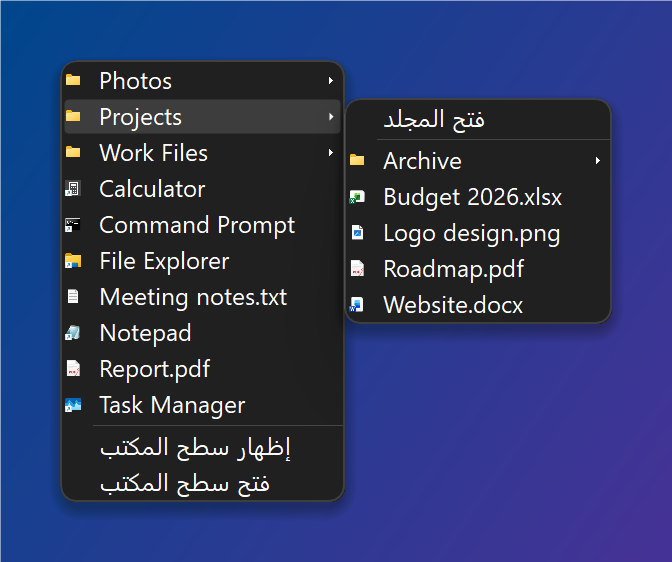
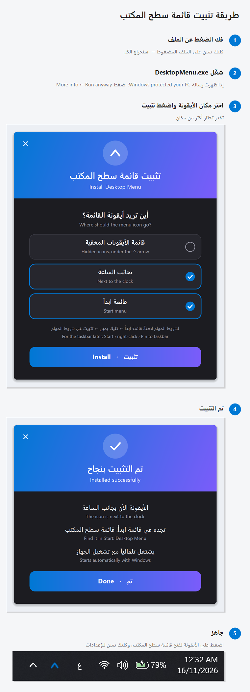

# قائمة سطح المكتب لويندوز 11

**يرجّع شريط "سطح المكتب" اللي كان في شريط المهام بويندوز 10.** تضغط أيقونة وحدة وتطلع لك قائمة بكل اللي على سطح المكتب، والمجلدات تنفتح داخل بعض، مثل علامة `»` القديمة بالضبط.

[English](README.md) · [التحميل](../../releases/latest) · ويندوز 10 و 11 · 14 لغة · مجاني ومفتوح المصدر (MIT)

> ويندوز 11 شال أشرطة الأدوات من شريط المهام، ومنها **شريط سطح المكتب**. هذا البرنامج الصغير (أقل من 100 كيلوبايت وبدون أي إضافات) يرجّع نفس الفكرة بدون ما يعدّل على مستكشف الملفات أو أي شي ثاني في ويندوز.

## المميزات

- **كل اللي على سطح المكتب بضغطة وحدة:** البرامج والاختصارات والملفات والمجلدات، كل واحد بأيقونته.
- **مجلدات متداخلة:** وقّف الماوس على أي مجلد وتنفتح محتوياته، مستوى بعد مستوى.
- **إظهار سطح المكتب للشاشة الرئيسية بس:** يصغّر النوافذ اللي عليها، والشاشات الإضافية تظل مثل ما هي. وضغطة ثانية ترجّع النوافذ.
- **مكان الأيقونة على كيفك:** جنب الساعة، أو تحت السهم `^`، أو في قائمة ابدأ ومنها تثبّتها في شريط المهام.
- **12 أيقونة جاهزة وتقدر تضيف أيقونتك:** من مربع `+` تضيف أي صورة PNG أو ICO أو JPG.
- **تصميم حديث:** قوائم بزوايا دائرية، وتمشي مع الوضع الداكن والفاتح.
- **14 لغة:** منها العربية والإنجليزية والفارسية والأردو.
- **صغير ونظيف:** ملف واحد، وما يحتاج صلاحيات مدير، والحذف يشيله بالكامل.

## التثبيت

1. نزّل آخر نسخة من **[صفحة التحميل](../../releases/latest)** وفك الضغط عنها.
2. شغّل `DesktopMenu.exe`.
   إذا طلعت رسالة "Windows protected your PC"، اضغط **More info** ← **Run anyway**. البرنامج غير موقّع رقمياً.
3. اختر اللغة، وبعدها اختر مكان الأيقونة، واضغط **تثبيت**.

### نقل الأيقونة جنب الساعة

إذا اخترت **بجانب الساعة**، بتلقاها هناك على طول. وإذا كانت تحت السهم `^`، **اسحبها بالماوس وحطها جنب الساعة**، وويندوز يحفظ مكانها.

### تثبيتها في شريط المهام

افتح **قائمة ابدأ**، واكتب **قائمة سطح المكتب**، وبعدها كليك يمين ← **تثبيت في شريط المهام**. ويندوز 11 ما يسمح للبرامج تثبّت نفسها هناك.

## الاستخدام

| الحركة | النتيجة |
|---|---|
| ضغطة على الأيقونة | قائمة سطح المكتب |
| كليك يمين على الأيقونة | الإعدادات: تغيير الأيقونة، ومجلد الأيقونات، والإغلاق، وإلغاء التثبيت |
| القائمة ← إظهار سطح المكتب | تصغير نوافذ الشاشة الرئيسية، وضغطة ثانية ترجّعها |

لحذف البرنامج: كليك يمين على الأيقونة ← **إلغاء التثبيت**.

## كلمات البحث

Windows 11 desktop toolbar · شريط سطح المكتب ويندوز 11 · قائمة سطح المكتب · إرجاع شريط أدوات ويندوز 10

## الرخصة

[MIT](LICENSE)

