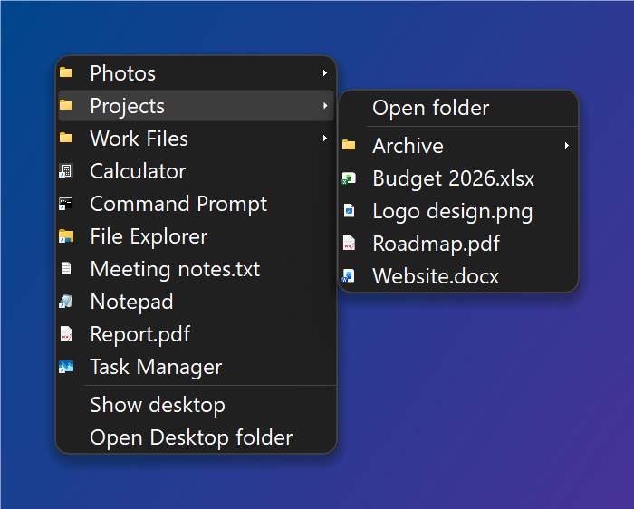
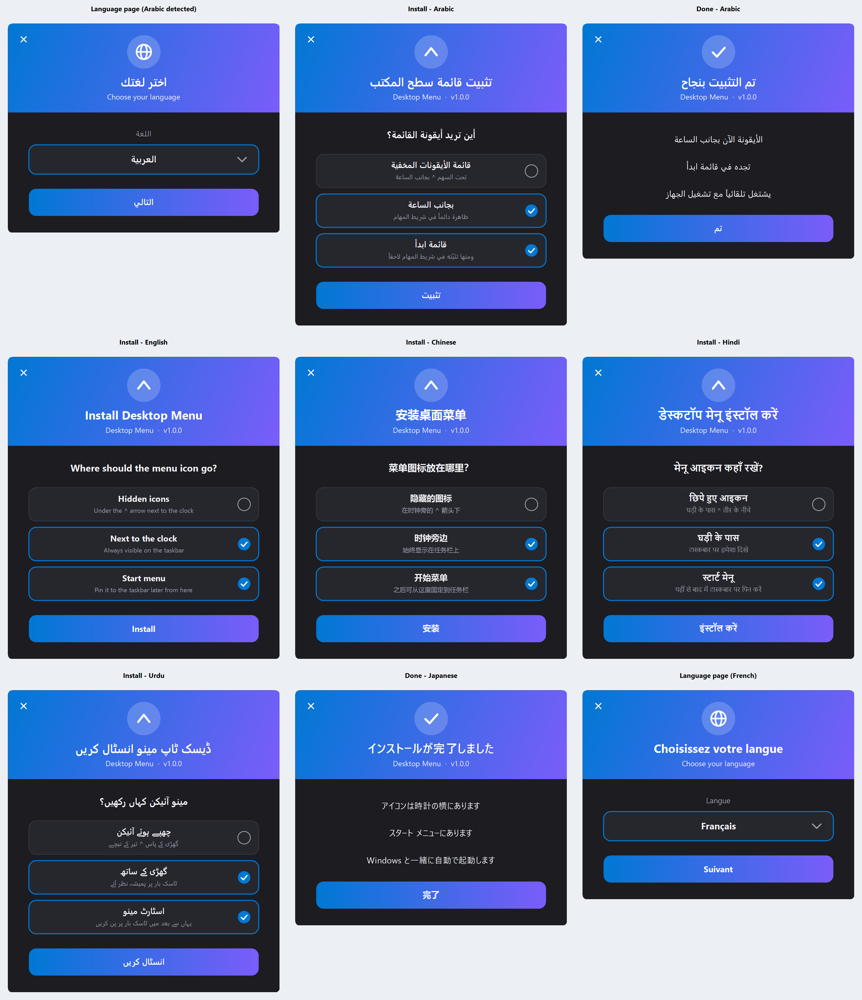
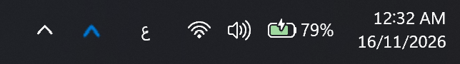

# Win11 Desktop Toolbar

**Bring back the Windows 10 "Desktop" taskbar toolbar on Windows 11.** Click one icon and get a menu of everything on your desktop, with cascading folders, just like the old `»` Desktop toolbar.

[العربية](README.ar.md) · [Download](../../releases/latest) · Windows 10 / 11 · 14 languages · Free & open source (MIT)



> Windows 11 removed taskbar toolbars, including the **Desktop toolbar**. This small app (under 100 KB, no dependencies) restores the same idea without patching Explorer or changing anything else in Windows.

## Features

- **Everything on your desktop in one click:** apps, shortcuts, files and folders, with their real icons.
- **Cascading folders:** hover a folder to browse inside it, level by level.
- **Show desktop for the main screen only:** minimizes windows on your main screen and leaves your other monitors alone. Click again to bring them back.
- **Lives next to the clock**, under the `^` hidden-icons arrow, or in the Start menu, so you can pin it to the taskbar from there.
- **12 built-in icons, plus your own:** use the `+` tile to add any PNG/ICO/JPG.
- **Modern look:** rounded menus that follow Windows dark/light mode.
- **14 languages:** English, العربية, Français, Español, Deutsch, Português, Türkçe, Русский, 中文, 日本語, हिन्दी, Bahasa Indonesia, فارسی, اردو.
- **Tiny and clean:** a single `.exe` with no admin rights needed. It installs to your user folder and uninstalls completely.

## Install

1. Download the latest zip from **[Releases](../../releases/latest)** and unzip it.
2. Run `DesktopMenu.exe`.
   If Windows shows "Windows protected your PC", click **More info › Run anyway**. The app is not code-signed.
3. Pick your language, choose where the icon goes, and press **Install**.



### Put the icon next to the clock

If you chose **Next to the clock**, it's already there. If the icon sits under the `^` arrow, **drag it out next to the clock**. Windows remembers the spot.



### Pin it to the taskbar

Open **Start**, type the app's name ("Desktop Menu" in your language), then **right-click › Pin to taskbar**. Windows 11 doesn't let apps pin themselves.

## Use

| Action | Result |
|---|---|
| Click the icon | Menu of your desktop, opening just above the taskbar |
| Right-click the icon | Settings: change icon, icons folder, close, uninstall |
| Menu › Show desktop | Minimize windows on the main screen (click again to restore) |

To uninstall: right-click the icon › **Uninstall**.

## Build from source

Uses only the C# compiler that ships with Windows (.NET Framework 4.x). No SDK needed.

```bat
build.cmd
```

`test-strings.ps1` checks that every text exists in all 14 languages.

## Contributing

Bug reports, translations and ideas are welcome. See [CONTRIBUTING.md](CONTRIBUTING.md).

## Keywords

Windows 11 desktop toolbar · Win11 taskbar toolbar · restore Windows 10 toolbar · desktop folder menu · cascading folders menu · quick launch Windows 11 · show desktop single monitor · system tray desktop menu

## License

[MIT](LICENSE)
